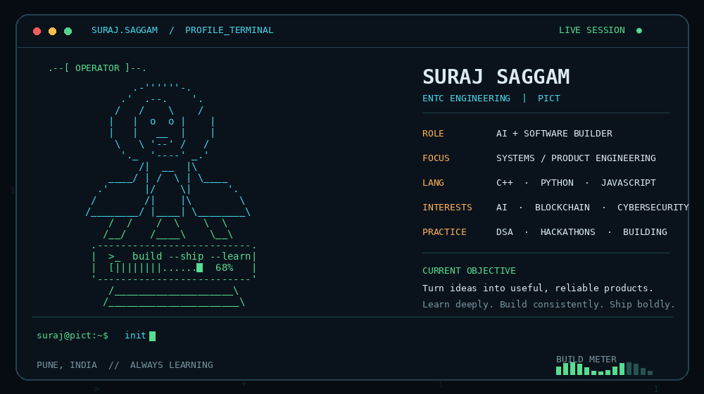

<!--
  GITHUB PROFILE README
  1. Replace YOUR_GITHUB_USERNAME everywhere with your GitHub username.
  2. Replace the LinkedIn / LeetCode placeholders with your real profile URLs.
  3. Upload suraj_ascii_profile.gif to the ROOT of this same repository.
  4. Delete this comment block after customizing, if you like.
-->

  

  <h1>Hi, I'm Suraj Saggam 👋</h1>
  
  

    
    
    
  

---

## `whoami` — About me

I'm an Electronics and Telecommunication Engineering student at **Pune Institute of Computer Technology (PICT)**, interested in the intersection of software, AI, and real-world engineering.

I enjoy taking a problem from an initial idea to a working system: understanding the domain, designing the architecture, building the core logic, and refining the product through testing.

- 🎓 Studying **Electronics and Telecommunication Engineering (ENTC)** at PICT.
- 💻 Primarily working with **C++ and Python**, while building with JavaScript and modern web technologies.
- 🧠 Practising **DSA** and strengthening problem-solving fundamentals.
- 🛠️ Interested in **AI/ML, backend systems, blockchain, cybersecurity, and data-driven applications**.
- 🤝 Enjoy collaborating on hackathons and team projects.

## `./toolkit` — Tech I work with

  

**Also exploring:** SQL Server, machine learning workflows, smart contracts, satellite-data applications, and system design.

## `projects --featured` — Things I've worked on

### NEXORA — Building Simulation & Intelligence
A building-simulation project combining first-principles modelling with an ML intelligence layer. The work includes energy baselines, occupancy forecasting, and anomaly detection using simulated building data.

**Focus:** Python · Simulation · Machine Learning · Forecasting

### COLLECTIVE — On-chain Group Payments
A group-payments platform concept built around blockchain workflows, developed for the Monad ecosystem.

**Focus:** Blockchain · Smart Contracts · Product Engineering

### Antardhi — Credit Intelligence Prototype
A Python-based credit-scoring prototype designed around different borrower personas, with outputs such as risk scores, tiers, confidence, anomaly flags, and reason codes.

**Focus:** Python · ML · Feature Engineering · Model Evaluation

### Student ERP — Database Engineering
A collaborative student ERP project using Microsoft SQL Server, with a modular database design spanning authentication, profiles, academics, attendance, examinations, finance, and library operations.

**Focus:** SQL Server · Database Design · ER Modelling · Git Collaboration

### Sahaj — Assistive Smart Spoon Concept
An assistive-device concept intended to help people with hand tremors eat more steadily, exploring sensor-based motion compensation and embedded control.

**Focus:** Embedded Systems · Arduino · IMU Sensors · Product Design

> Add links to the repositories above as they become public. I have left them as descriptions rather than inserting unverified URLs.

## `currently_learning` — What I'm improving

- Writing cleaner, more efficient C++ and strengthening DSA fundamentals.
- Building reliable backend services and understanding system architecture.
- Applying machine learning to practical engineering problems.
- Improving software design, testing, and collaboration workflows.

## `activity` — GitHub stats

Replace `YOUR_GITHUB_USERNAME` in the image URLs below with your exact GitHub username.

  
  

  

## `connect` — Find me online

- **GitHub:** [YOUR_GITHUB_USERNAME](https://github.com/YOUR_GITHUB_USERNAME)
- **LinkedIn:** [Add your LinkedIn profile](https://www.linkedin.com/in/YOUR_LINKEDIN_USERNAME/)
- **LeetCode:** [Add your LeetCode profile](https://leetcode.com/YOUR_LEETCODE_USERNAME/)
- **Email:** Add your preferred public contact email here.

---

  <i>“Learn deeply. Build consistently. Ship thoughtfully.”</i>
    
  

