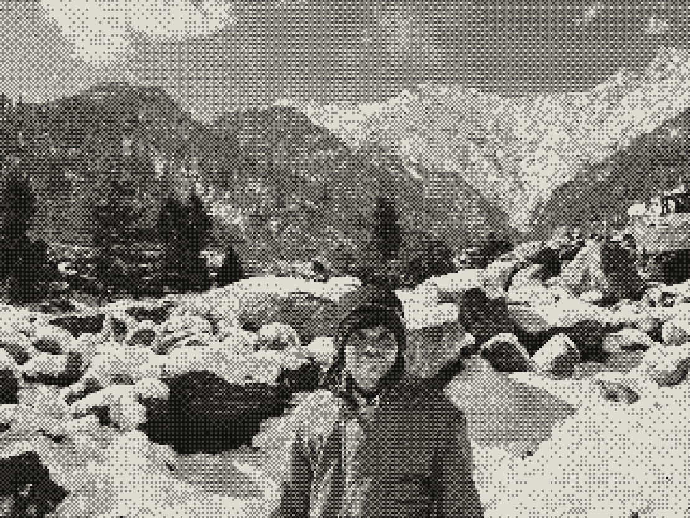

  

  <h2>GitHub & Problem-Solving Stats</h2>
  
    
  
  
   
  

---

## About Me

Hi, I'm **Suraj Saggam**, a 20-year-old Electronics and Telecommunication Engineering student at **Pune Institute of Computer Technology (PICT), Pune**.

- **Course:** B.E. in Electronics & Telecommunication Engineering
- **Graduation:** 2028 (2024–2028)
- **CGPA:** 9.44
- **Problem Solving:** 400+ LeetCode problems solved

